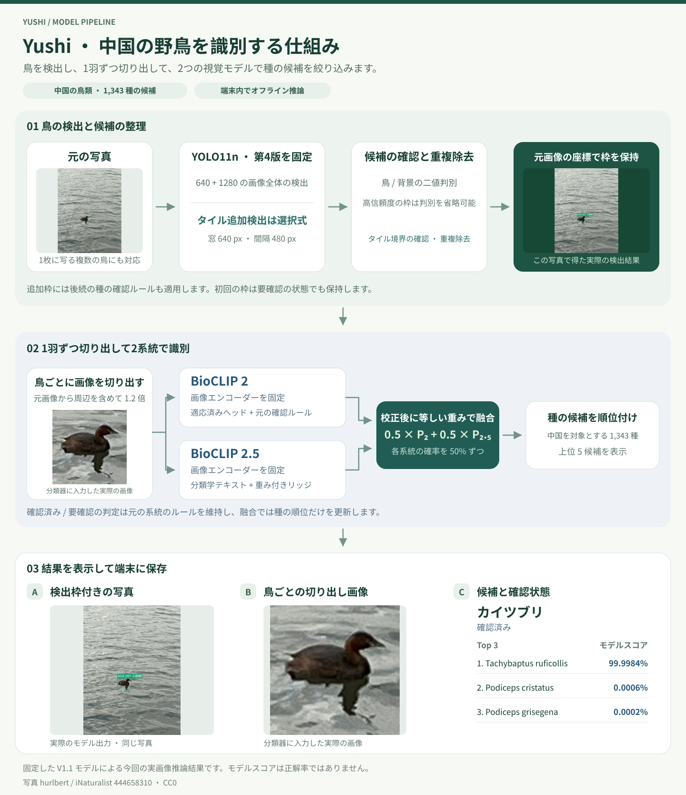

# Yushi 中国の野鳥識別モデル

**YOLO11 · BioCLIP · オフライン推論 · コンピュータビジョン**

[English](README.md) · [简体中文](README.zh-CN.md) · 日本語

**非商用利用のみ。** 作者独自の成果物と第三者の構成要素には、それぞれの条件が適用されます。[利用条件](USAGE.md)をご覧ください。

Yushi（羽识）は写真の中の鳥を検出し、保持した枠ごとに画像を切り出して、鳥種の候補順位を提示します。主な対象は**中国に分布する鳥類**で、候補リストには **1,343 種**を収録しています。Windows アプリは端末上で動作し、検出枠、実際の分類入力画像、候補種、確認済み・要確認の状態を表示します。

構成は、微調整した **YOLO11n 鳥検出器**、**鳥と背景の判別器**、および固定した **BioCLIP 2・BioCLIP 2.5** を基盤とする適応済み分類系統です。第4版の検出器は固定されており、通常モードとタイルモードは同じ検出重みを使用します。

本リポジトリには、仕組みの説明、実行可能なタイル処理・引き継ぎのサンプル、実推論画像、検証記録を収録しています。完全なデスクトップ実行環境とモデル重みは別パッケージです。クローン後に実行できるのはコードサンプルで、完全な識別アプリには対応するプログラムとモデル資産が必要です。

## 識別の仕組み



図中の写真、検出枠、切り出し画像は、固定済みアプリを今回再実行した結果です。対応ファイルと実行記録は下の「今回の実推論例」から確認できます。

### 1. 鳥の候補領域を検出

まず推論サイズ 640 で画像全体を検出し、次に推論サイズ 1280 で画像全体を追加検出します。どちらも重みを固定した第4版の YOLO11n を使用します。

信頼度の低い検出候補は背景判別器で確認します。固定設定の高信頼度条件を満たす候補は、この判別を省略します。この段階では鳥らしい領域を見つけ、その後で具体的な種を識別します。

### 2. 必要に応じてタイルで追加検出

タイルモードでは、元画像上の重なりのある領域を追加で調べます。画像サイズが許す場合、窓は 640 × 640 ピクセル、通常の移動幅は 480 ピクセルです。ある窓の端にいる鳥を、隣接する窓でより完全に捉える機会を作ります。

検出枠は元画像の座標に戻します。内部タイル境界に接する候補と重複候補を除去し、優先する枠を保持します。1280 の全体追加検出とタイル処理から追加する枠は、元の BioCLIP 2 系統の採用条件を満たす必要があります。初回の枠は、鳥種が要確認でも保持します。

### 3. 元画像から1羽ずつ切り出す

保持した各枠について、元の写真から **1.2 倍の周辺領域**を含む正方形画像を生成します。画像外にはみ出す部分は固定の灰色で埋めます。鳥を中心に置きながら、周辺の情報も少し残す方法です。

2つの鳥種系統は同じ保存済みの切り出し画像を受け取り、それぞれのエンコーダーに必要な前処理を行います。実際の分類入力画像と、検出枠だけを切り出した画像を別々に保存します。複数の枠があれば、枠ごとに識別子、切り出し、分類結果を作ります。下の実推論例では、それぞれ1羽を保持しています。

### 4. 候補順位を融合し、確認判定を引き継ぐ

固定した BioCLIP 2 と BioCLIP 2.5 で特徴を抽出し、中国の鳥類向けに適応した分類系統で処理します。標準設定の `blend50_N_ridge` は、校正した2系統の種別分布を同じ重みで融合します。

```text
最終候補順位 = 0.50 × BioCLIP 2 系統 + 0.50 × BioCLIP 2.5 系統
```

融合は候補順位を更新します。採用判定、鳥らしさ、要確認の状態は元の BioCLIP 2 系統から引き継ぎます。候補スコアと「確認済み」は異なる情報です。

## 今回の実推論例

**2026年11月10日**に、固定した Windows GPU アプリで、既存の CC0 サンプル写真2枚を再処理しました。検出はタイルモード、分類は選定済みの融合方式です。既知の写真による新しい実行結果を示すもので、新たな独立精度評価セットではありません。

| 写真 | 保持した鳥数 | 第1候補 | アプリの状態 | 実際の分類入力サイズ | タイル追加枠 |
| --- | --- | --- | --- | --- | --- |
| カイツブリ | 1 | *Tachybaptus ruficollis* | 確認済み | 137 × 137 | 0 |
| アオサギ | 1 | *Ardea cinerea* | 確認済み | 76 × 76 | 0 |

- カイツブリ — [元写真のプレビュー](media/recognition-example/original.jpg)、[保存された検出結果](media/recognition-example/annotated.jpg)、[実際の分類入力](media/recognition-example/crop.png)。
- アオサギ — [元写真のプレビュー](media/recognition-example/grey-heron/original.jpg)、[保存された検出結果](media/recognition-example/grey-heron/annotated.jpg)、[実際の分類入力](media/recognition-example/grey-heron/crop.png)。
- [実行記録](evidence/recognition-example.json)には、候補、座標、実行デバイス、モデル・設定のハッシュ、切り出しのハッシュ、写真の出典を収録しています。

各写真で4つのタイル窓を調べ、通常モードの結果を保持しました。推論前後で検出器と設定のハッシュは一致しています。公開 JPEG はメタデータの除去と再エンコードのみを行い、検出枠は描き直していません。各 `crop.png` は、両分類系統に渡した入力からアプリが保存した PNG とバイト単位で一致します。

以前に保存した[カイツブリの処理例](media/little-grebe-workflow.png)と[アオサギの処理例](media/grey-heron-workflow.png)も収録しています。写真のクレジットと基盤モデルの出典は [CREDITS.md](CREDITS.md) をご覧ください。

## 事前学習モデルと適応方法

| 構成要素 | 事前学習の基盤 | V1.1 の学習・適応 |
| --- | --- | --- |
| 鳥検出器 | Ultralytics **YOLO11n**、`yolo11n.pt` | 鳥の枠アノテーション、誤検出しやすい負例、複雑な場面で鳥の単一クラス検出に微調整。アプリでは第4版を固定して使用します。 |
| 背景判別器 | ImageNet 事前学習済み **YOLO11n-cls**、`yolo11n-cls.pt` | **鳥の切り出し 6,270 枚**と**背景の切り出し 5,778 枚**で二値分類に微調整し、低信頼度の候補を確認します。 |
| BioCLIP 2 系統 | Imageomics **BioCLIP 2**、ViT-L/14 | 画像エンコーダーは固定。**80 種・736 枚のサポート写真**を使って分類ヘッドと確認ルールを適応し、元の採用判定も提供します。 |
| BioCLIP 2.5 系統 | Imageomics **BioCLIP 2.5**、ViT-H/14 | 画像エンコーダーは固定。分類学的テキストのスコアに、**80 種・1,434 枚の有効な切り出し**で学習した重み付きリッジ回帰ヘッドを組み合わせます。 |
| 最終候補順位 | 校正した2系統の出力 | 同じ重みで確率を融合し、元の採用・要確認判定を保持します。 |

過去の検出学習記録には **CUB-200-2011、COCO、FBD-SV-2024、IBERBIRDS、Web由来の難しい負例**が含まれます。種識別のヘッドには、中国の鳥類を中心とする別のサポート写真群を使い、iNaturalist の公開観察写真も含めています。鳥の枠と負例場面は検出に、種名付き写真は分類の適応に使います。

両方の BioCLIP 画像エンコーダーは事前学習済みの重みを保持しています。独自の適応は分類ヘッド、確認ルール、確率融合に集中しており、提供構成でエンコーダー全体を再学習したわけではありません。

対象範囲は **候補リスト 1,343 種**、**上記サポートデータ 80 種**、**過去の評価 95 種**でそれぞれ異なります。候補リストに含まれることだけでは、その種の測定済み識別精度は分かりません。

## 通常モードとタイルモード

| 項目 | 通常モード | タイルモード |
| --- | --- | --- |
| 固定した 640 全体初回検出 | あり | あり |
| 1280 全体追加検出 | あり | あり |
| 640 ピクセルの重複窓 | なし | あり、通常の移動幅 480 ピクセル |
| 第4版の検出重み | 同じ固定重み | 同じ固定重み |
| 個体別の切り出しと鳥種識別 | あり | あり |
| 通常モードの既存結果 | 保持 | 元の出力を先頭部分として保持 |

幅と高さがともに 640 ピクセル以下の場合は、追加の窓を作りません。上限は **256 タイル**です。上限を超える場合は対象領域を小さくするよう案内し、画像の一部だけを調べて完了扱いにはしません。画像端に窓を合わせるため、重なりが通常の25%を超える場合もあります。

初回検出の固定設定は `imgsz=640`、`conf=0.16`、`iou=0.7`、`classes=[0]` です。背景判別の閾値は `0.15`、検出信頼度が `0.35` 以上の場合はその判別を省略します。タイル追加検出の候補閾値は別の `0.05` で、その後に選別と重複除去を行います。これらは処理段階ごとの設定で、互いに置き換える調整値ではありません。

タイル処理は推論方法であり、追加学習した別の `.pt` ではありません。全体縮小で小さくなる鳥を、より狭い範囲で調べる機会を増やします。追加候補にも判別が必要で、再現率への効果は実際の用途の画像で検証する必要があります。

## 完全な Windows アプリの使い方

以下は別途パッケージされたデスクトップアプリの操作です。

1. パッケージ全体を書き込み可能なフォルダーに展開し、`鸟类识别.exe` または `启动鸟类识别.cmd` を起動します。
2. 写真を1枚または複数枚追加します。GUI の初期値はタイル追加検出、高精度融合版、NVIDIA 優先の自動選択です。
3. 検出回数を減らす場合は通常モード、追加で局所領域を調べる場合はタイルモードを選びます。鳥種分類器の設定は独立しており、選定融合版と従来の N 系統を比較できます。
4. 識別を開始します。実際の処理段階を表示し、初回のモデル読み込みは後続写真の処理より時間がかかります。
5. 写真を選択して検出枠を確認し、次に鳥を選択して実際の切り出し、中国語種名、学名、上位5候補を確認します。
6. 結果フォルダーを開いて保存ファイルを確認します。GUI の一覧を消しても保存済みの結果は削除されません。

アプリはローカル写真と一括処理に対応します。カメラの自動起動や遠隔受信サーバーは含みません。選択した写真をアプリがサーバーにアップロードすることはありません。

### 出力ファイルとスコア

| 保存ファイル | 内容 |
| --- | --- |
| `snapshot.png` | 推論に使った RGB 画像のスナップショット |
| `annotated.png` | 検出枠と表示結果 |
| `bird_001.png` など | 鳥種系統に実際に渡した 1.2 倍の周辺付き正方形画像 |
| `bird_001_tight.png` など | 検出枠の範囲だけを切り出した画像 |
| `result.json` | 座標、上位5候補、確認状態、切り出しのパス、検出元、処理時間 |

元写真は保持し、実行ごとに個別の結果ディレクトリを作ります。個体の識別子により、検出枠、切り出し、種の結果を対応付けます。

**検出信頼度**は領域の検出評価、**種のスコア**はその切り出しの候補順位、**確認済み／要確認**は固定判定ルールに基づく状態です。1に近い表示スコアは1枚の画像に対するモデル出力であり、システム全体の実測精度や正解の保証を表しません。

## 評価結果

| 評価 | 結果と範囲 |
| --- | --- |
| 過去の通常フローの鳥種評価 | **95 種・188 枚**で第1候補の正解が **172/188、91.49%**。従来の分類器は **169/188**。未検出写真は不正解として集計しました。 |
| 11月6日の既存写真回帰テスト | **197/197** 枚を処理し、元の検出を保持。空の鳥70枚、負例118枚、鳥種写真9枚を含みます。 |
| 空の鳥の注釈枠との対応 | 通常 **69/70**、タイル **69/70**。小さな対象は両モードとも **5/5**。 |
| 検出枠が出た負例写真 | 両モードとも **10/118** 枚、各モード合計14枠。 |
| 鳥種が確認済みとなった負例写真 | 両モードとも **0/118** 枚。誤検出枠と種の確認は別に集計しています。 |
| この回帰テストのタイル処理 | **999 窓、309 候補、採用された追加枠0件**。 |
| 初回検出の引き継ぎ | 1台の Windows GPU PC で JSON 往復を確認。後続処理の初回 YOLO 再実行 **0回**、異なる画素と変更されたパケットを拒否。 |

188枚の評価は選定済み通常フローの鳥種精度、197枚の回帰は既存の確認用写真に対する結果保持と誤検出、今回の2枚は現在の実行と保存画像を示します。対象と目的が異なるため、過去の91.49%をタイルモードや全1,343種の精度に読み替えることはできません。

[検証データ](evidence/validation.json)と[今回の実行記録](evidence/recognition-example.json)を参照してください。タイル回帰テストでは既存結果の保持を確認しましたが、その写真群で再現率の追加改善は示していません。

## 初回検出と後続処理の引き継ぎ

完全なアプリは2つの論理段階を提供します。初回側は固定した640検出器と背景判別器を実行します。後続側は**同じ元の RGB 画像**と `bird-initial-v1` JSON を受け取り、検証済みの枠を再利用して追加検出、切り出し、種の識別を続けます。

パケットには画像サイズ、画素 SHA-256、検出モデルのハッシュ、検出設定、枠、件数を結び付けます。検証器はパケットのダイジェストと各フィールドを調べます。ダイジェストは内容の不一致を検出するもので、本人認証や電子署名ではありません。

有効なパケットで初回検出の重複実行を省略し、追加検出は選択モードに従って行います。オフライン処理では初回枠が空でも追加検出へ進めます。将来のカメラが初回検出に成功したフレームだけを送る場合、未検出で送られなかったフレームを後段のタイル処理で回復することはできません。

この分担は1台の Windows GPU PC 上で確認した処理インターフェースです。リポジトリにはネットワークサービスや実機検証済み Raspberry Pi 配備は含まれていません。

## リポジトリのコードサンプルを実行

サンプルは Python 標準ライブラリと合成 RGB データを使い、タイル座標と初回パケットの検証を行います。モデル重みの読み込みや鳥種推論は行いません。

```bash
git clone https://github.com/mmax911110-lgtm/yushi-china-bird-recognition.git
cd yushi-china-bird-recognition
python review/demo.py
```

1440 × 960 のサンプルサイズに対する6窓、元画像座標への変換、内部左境界、JSON 引き継ぎの1枠、異なる画素の拒否が出力されます。`review/tiling.py` はアプリから抽出したタイル・引き継ぎモジュール、`review/demo.py` は対応する小さな実行例です。

## ファイル構成

```text
.
├── README.md / README.zh-CN.md / README.ja.md
├── USAGE.md                       利用条件と第三者の適用範囲
├── CREDITS.md                     モデルと写真の出典
├── review/
│   ├── demo.py                    標準ライブラリのコード例
│   └── tiling.py                  タイル座標と引き継ぎ検証
├── evidence/
│   ├── validation.json            過去の評価と回帰テスト
│   └── recognition-example.json   今回の実行記録とハッシュ
└── media/
    ├── recognition-pipeline.*.svg  各言語の処理図
    ├── recognition-example/
    │   ├── original.jpg / annotated.jpg / crop.png
    │   └── grey-heron/             2枚目の同種ファイル
    ├── little-grebe-workflow.png   以前の保存済み処理例
    └── grey-heron-workflow.png
```

## 完全な配備に必要な資産と環境

完全なシステムには、以下の組み合わせが必要です。YAMLや検出重みだけを置き換えても、残りの鳥種識別機能は揃いません。

| 構成要素 | 必要な役割 |
| --- | --- |
| アプリとランチャー | GUI、検出、切り出し、分類、保存、起動 |
| 検出器・判別器の `.pt` | 固定された鳥検出と背景判別 |
| BioCLIP 重みとモデル設定 | 2つの事前学習画像エンコーダー |
| 種分類ヘッドとテキスト特徴 | 適応済みヘッド、分類学的スコア、背景特徴 |
| 固定設定とラベル | 閾値、種の順序、融合方式、モデル識別情報 |
| Python と推論実行環境 | 対応する PyTorch、OpenCLIP、画像処理、Tkinter、ネイティブ依存関係 |
| ライセンスと完全性情報 | 構成要素の条件、出典、ファイルハッシュ検証 |

参照アプリは **Windows x64** で、検証機の GPU は **NVIDIA GeForce RTX 5060 Laptop GPU、VRAM 8 GB** です。鳥種の参照実行は CUDA BF16 推論を使用します。CPU選択もありますが、CPUや他のGPU構成では同じ範囲の精度回帰を終えていません。初回読み込み、写真サイズ、タイル数、分類方式により時間とメモリ使用量が変わります。

Windows用の実行環境は Raspberry Pi の Linux ARM にそのまま移せません。本リポジトリの測定には、Raspberry Pi 配備、速度、最低ハードウェア条件の実機検証は含まれません。

## 利用と出典

作者独自の成果物は、個人学習、教育、非商用研究に限り利用できます。商用利用には作者の事前の書面による同意が必要です。第三者のコード、モデル、写真には各々の元のライセンスが適用され、本声明はその条件を変更しません。

具体的な範囲は[利用条件](USAGE.md)、モデルと写真の由来は[出典](CREDITS.md)をご覧ください。公開サンプル写真は CC0 として記録されています。学習データセットと完全なモデル資産は本リポジトリに含まれません。

**キーワード** 中国の野鳥、鳥種識別、YOLO11、BioCLIP、タイル検出、コンピュータビジョン、オフライン推論、野生動物 AI
