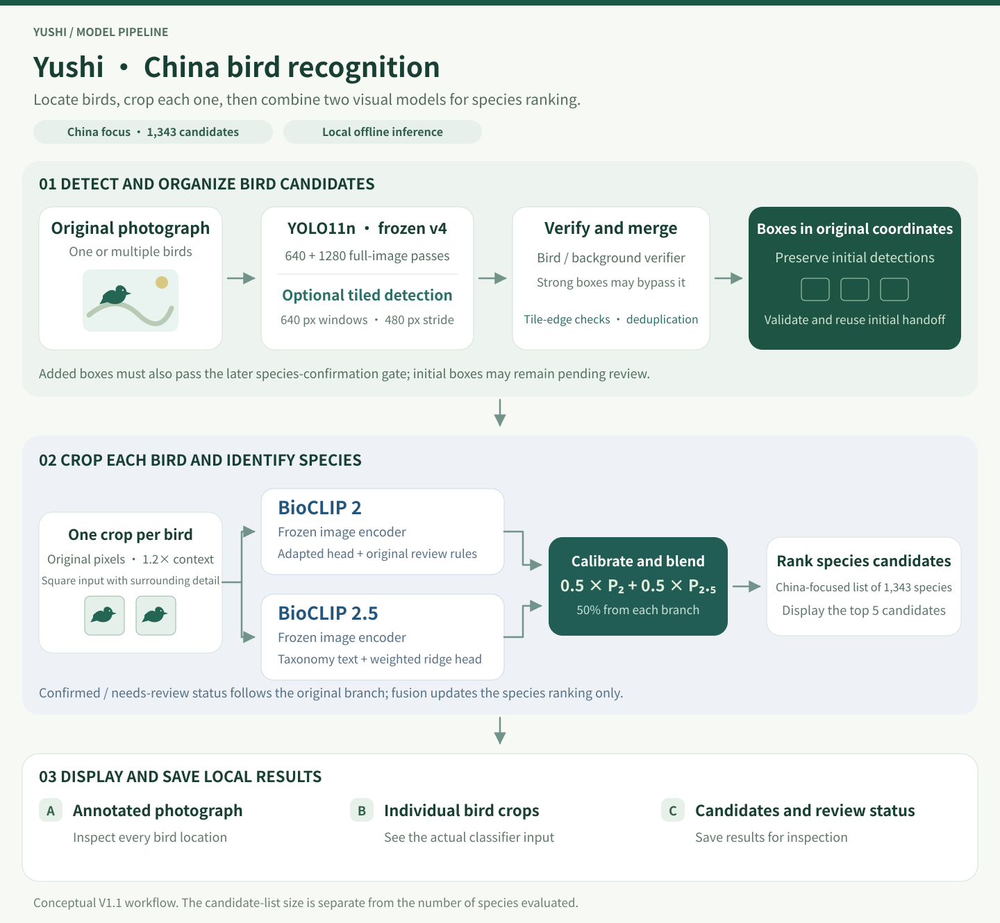

# Yushi China Bird Recognition Model

**YOLO11 · BioCLIP · Offline inference · Computer vision**

English · [简体中文](README.zh-CN.md) · [日本語](README.ja.md)

**Non-commercial use only.** The author's original contributions and third-party components have separate terms. See [USAGE.md](USAGE.md).

Yushi (羽识) finds birds in photographs, crops each retained detection, and ranks species candidates. It focuses on **birds found in China**, with a reference list of **1,343 species**. Its Windows application runs locally and lets the user inspect detection boxes, the actual classifier input, species suggestions, and confirmation or review status.

The recognition system combines a fine-tuned **YOLO11n bird detector**, a **bird/background verifier**, and adapted classifier branches built on frozen **BioCLIP 2 and BioCLIP 2.5** encoders. The fourth-version detector remains frozen. Normal and tiled modes use the same detector weights.

This repository contains the architecture, executable tiling and handoff examples, real inference images, and validation records. The complete desktop runtime and model weights are distributed separately; cloning this repository provides the code example, rather than a complete installed recognizer.

## Recognition pipeline

This experiment branch also provides an [optional per-bird specialist-review desktop GUI](desktop_review/README.md), launched with `启动相似种复核GUI.cmd` and the separately installed NVIDIA runtime. It keeps the original batch, normal/tiled and dual-BioCLIP results. Willow review is an opt-in frozen experiment; thrush and sparrow reviewers remain inactive. Specialist advice never overwrites the original recognition.



The photographs, detection overlay, and crop in the diagram come from a fresh local run of the frozen application. Their source files and run record are linked below.

### 1. Find bird candidates

The full-image detector first uses an inference size of 640. A supplemental full-image pass at 1280 checks the photo at a higher input resolution. Both use the frozen fourth-version YOLO11n detector.

The background verifier checks low-confidence detections. Strong detections bypass that verifier according to the frozen configuration. This stage answers whether a region is a plausible bird; species recognition comes later.

### 2. Add optional tiled detection

Tiled mode adds overlapping windows from the original image. Each tile is 640 pixels wide and high where the image permits, with a normal stride of 480 pixels. The overlap gives a bird near one tile boundary another opportunity to appear away from a boundary.

Tile coordinates are mapped back to the original image. Candidates touching internal tile edges are rejected, and duplicate candidates are suppressed while retaining priority boxes. Supplemental boxes from the 1280 and tiled passes must meet the original BioCLIP 2 branch's acceptance rules. Initial detections remain available even when their species is uncertain.

### 3. Crop each retained bird

Every retained box produces its own square crop from the original photograph, with **1.2× context** around the detected extent. Areas extending outside the image receive fixed gray padding. This preserves some surrounding visual context while keeping the bird central.

Both species branches receive the same saved crop before their own encoder preprocessing. The application saves this actual input separately from a tight bounding-box crop. If several boxes are retained, each gets its own crop, classification result, and identifier. The examples below each contain one retained bird.

### 4. Rank species and retain review decisions

Frozen BioCLIP 2 and BioCLIP 2.5 encoders produce features for classifier branches adapted toward Chinese birds. The selected configuration, `blend50_N_ridge`, combines their calibrated species distributions with equal weights.

```text
final species ranking = 0.50 × BioCLIP 2 branch + 0.50 × BioCLIP 2.5 branch
```

This fusion updates the candidate ranking. Acceptance, birdness, and review status retain the original BioCLIP 2 branch's decisions. A high ranking score and a confirmed result are distinct fields.

## Fresh inference examples

On **2026-11-10**, the frozen Windows GPU application was run again on the two existing CC0 demonstration photographs using tiled detection and the selected fusion classifier. These are fresh executions of known examples, not a new held-out accuracy benchmark.

| Photo | Retained birds | First candidate | Application status | Actual classifier crop | Added tile boxes |
| --- | --- | --- | --- | --- | --- |
| Little Grebe | 1 | *Tachybaptus ruficollis* | Confirmed | 137 × 137 | 0 |
| Grey Heron | 1 | *Ardea cinerea* | Confirmed | 76 × 76 | 0 |

- Little Grebe — [original photograph](media/recognition-example/original.jpg), [saved detection overlay](media/recognition-example/annotated.jpg), [actual classifier crop](media/recognition-example/crop.png).
- Grey Heron — [original photograph](media/recognition-example/grey-heron/original.jpg), [saved detection overlay](media/recognition-example/grey-heron/annotated.jpg), [actual classifier crop](media/recognition-example/grey-heron/crop.png).
- [Run evidence](evidence/recognition-example.json) records the candidates, boxes, device, model and configuration hashes, crop hashes, and image provenance.

Each photo produced four tile windows and retained the normal-mode result. The detector and configuration hashes were unchanged after inference. The published JPEG previews remove metadata and re-encode saved images; detection boxes were not redrawn. Each published `crop.png` is byte-identical to the PNG saved from the shared classifier input.

Earlier saved walkthroughs remain available for the [Little Grebe](media/little-grebe-workflow.png) and [Grey Heron](media/grey-heron-workflow.png). Photo attribution and upstream model sources are in [CREDITS.md](CREDITS.md).

## Pretrained foundations and local adaptation

| Component | Pretrained foundation | Adaptation used in V1.1 |
| --- | --- | --- |
| Bird detector | Ultralytics **YOLO11n**, `yolo11n.pt` | Fine-tuned for a single bird class using annotated birds, hard negatives, and complex scenes. The application freezes the fourth-version detector. |
| Background verifier | ImageNet-pretrained **YOLO11n-cls**, `yolo11n-cls.pt` | Fine-tuned as a binary verifier on **6,270 bird crops** and **5,778 background crops**. Used for lower-confidence detections. |
| BioCLIP 2 branch | Imageomics **BioCLIP 2**, ViT-L/14 | Frozen image encoder. Classifier-head adaptation and review rules developed using **736 support photos across 80 species**. The selected branch also supplies the original acceptance decisions. |
| BioCLIP 2.5 branch | Imageomics **BioCLIP 2.5**, ViT-H/14 | Frozen image encoder. Taxonomy text scores combined with a weighted ridge classifier fitted on **1,434 usable crops across 80 species**. |
| Final ranking | Calibrated output of both branches | Equal-weight probability fusion, retaining the original acceptance and review decisions. |

Historical detector-training records list **CUB-200-2011, COCO, FBD-SV-2024, IBERBIRDS, and web hard negatives**. Species-head adaptation uses separate China-oriented support photo pools, including public iNaturalist observations. These sources serve different roles: bird boxes and negative scenes train detection, while species-labeled support images adapt classification.

The BioCLIP image encoders retain their pretrained weights. The local species adaptation is in the classifier heads, review rules, and probability fusion. The shipped configuration does not imply an end-to-end retraining of either BioCLIP encoder.

Three counts describe different scopes: **1,343 candidate species**, **80 species in the cited support sets**, and **95 species in the historical evaluation**. A species appearing in the candidate list does not establish its measured accuracy.

## Detection modes

| Setting | Normal mode | Tiled mode |
| --- | --- | --- |
| Frozen 640 full-image initial pass | Yes | Yes |
| 1280 full-image supplemental pass | Yes | Yes |
| 640-pixel overlapping windows | No | Yes, normal stride 480 pixels |
| Fourth-version detector weights | Same frozen weights | Same frozen weights |
| Per-bird crop and species recognition | Yes | Yes |
| Existing normal-mode detections | Retained | Retained as the original output prefix |

For images no larger than 640 pixels in either dimension, tiled mode adds no windows. The scanner allows at most **256 tiles**. If a photograph needs more, it asks for a smaller region instead of silently scanning only part of the image. Border alignment can increase overlap beyond the usual 25%.

The initial detector settings are `imgsz=640`, `conf=0.16`, `iou=0.7`, and `classes=[0]`. The background-verifier threshold is `0.15`; detections with confidence at least `0.35` bypass it. Supplemental tile detection uses its own lower candidate threshold, `0.05`, followed by screening and deduplication. These are different stages, not interchangeable threshold recommendations.

Tiling is an inference option, not a second trained `.pt` model. Its practical purpose is to examine smaller image regions before the bird becomes too small after full-image resizing. Additional computation can also introduce candidates that require rejection. Its benefit must be measured on the intended image distribution.

## Using the complete Windows application

The following workflow applies to the separately packaged desktop application.

1. Fully extract the package into a writable folder. Start `鸟类识别.exe` or `启动鸟类识别.cmd`.
2. Add one or several photos. The GUI defaults to tiled detection, the selected fusion classifier, and automatic NVIDIA selection.
3. Choose **normal** for fewer detection passes, or **tiled** for additional region checks. The separate species-classifier option offers the selected fusion and the earlier N branch for comparison.
4. Start recognition. The application displays actual processing stages; the first model load takes longer than subsequent images.
5. Select a photograph to inspect its overlay, then select a bird to inspect its actual crop, Chinese name, scientific name, and top-five candidates.
6. Open the result folder to inspect or retain the files. Clearing the GUI list does not delete saved results.

The application handles local photos and batches. It does not automatically open a camera or implement a remote receiving service. Selecting a photo does not upload it to a server.

### Result files and score interpretation

| Saved item | Meaning |
| --- | --- |
| `snapshot.png` | RGB snapshot used for inference |
| `annotated.png` | Bird boxes and displayed results |
| `bird_001.png`, etc. | Actual 1.2× square context crop supplied to the species branches |
| `bird_001_tight.png`, etc. | Tight crop of the detection box |
| `result.json` | Boxes, top-five species, review status, crop paths, processing origins, and timings |

The source photo is preserved. Each run saves into a separate result directory. Per-bird identifiers associate each box with its crop and species result.

**Detector confidence** scores a detection region. **Species score** ranks candidates for that crop. **Confirmed / needs review** follows the frozen acceptance rules. A displayed score near 1 is a model output for one image, not a measured overall accuracy or a guarantee that the bird is correctly identified.

## Measured results

| Evaluation | Result and scope |
| --- | --- |
| Historical full-image species test | **172/188 correct first choices**, or **91.49%**, across **95 species**. The prior classifier scored **169/188**. A photo with no detection counts as incorrect. |
| Existing-photo regression, November 6 | **197/197** images completed with original detections preserved. The set contains 70 sky scenes, 118 negative photos, and 9 species photos. |
| Sky bird box coverage | Normal **69/70**; tiled **69/70**. Small sky targets **5/5** in both modes. |
| Negative photos with boxes | **10/118** in each mode, with 14 boxes per mode. |
| Negative photos with a confirmed species | **0/118** in each mode. Detection false positives and species confirmations are counted separately. |
| Tiling during that regression | **999 windows**, **309 candidates**, **0 accepted additional boxes**. |
| Initial-detection handoff | JSON round trip on one Windows GPU PC, **0 repeated initial YOLO calls** during continuation; changed pixels and altered packets rejected. |

The 188-photo species test measures the selected normal workflow. The 197-photo regression checks retention and error behavior on previously used controls. The two fresh examples illustrate current execution and saved crops. Their sample sets and purposes differ. The historical 91.49% does not establish the accuracy of tiled mode or all 1,343 species.

See [validation data](evidence/validation.json) and the separate [fresh-example evidence](evidence/recognition-example.json). The regression confirms preservation on those samples; it did not demonstrate additional recall from tiling on that set.

## Initial-detection handoff

The complete application exposes two logical stages. The initial stage runs the frozen 640 detector and background verifier. The processing stage accepts the **same original RGB image** plus a `bird-initial-v1` JSON packet, validates them, and reuses the initial boxes before continuing supplemental detection and classification.

The packet binds image dimensions and pixel SHA-256, detector-model hashes, detector configuration, boxes, and counts. The validator checks the packet digest and these fields. The digest detects inconsistent content; it is not authentication or a digital signature.

A valid packet skips the repeated initial pass. Supplemental passes still run according to the selected detection mode. Even an empty initial packet can continue to supplemental detection in the offline workflow. If a future camera device transmits only frames with an initial hit, a missed and untransmitted frame cannot be recovered by later tiling.

This split has been exercised on one Windows GPU PC. It is a processing interface, not an included network protocol or a verified Raspberry Pi deployment.

## Run the repository's code example

The example uses the Python standard library and synthetic RGB data to exercise tile geometry and packet validation. It does not load model weights or run species inference.

```bash
git clone https://github.com/mmax911110-lgtm/yushi-china-bird-recognition.git
cd yushi-china-bird-recognition
python review/demo.py
```

The output reports six windows for a 1440 × 960 fixture, a tile box mapped to original-image coordinates, an internal left edge, one JSON-handoff box, and rejection of mismatched pixels. `review/tiling.py` is the extracted tiling and packet module from the application; `review/demo.py` is its small executable example.

## Repository contents

```text
.
├── README.md / README.zh-CN.md / README.ja.md
├── USAGE.md                       Usage terms and third-party scope
├── CREDITS.md                     Model and photo attribution
├── review/
│   ├── demo.py                    Standard-library code example
│   └── tiling.py                  Tile geometry and handoff validation
├── evidence/
│   ├── validation.json            Historical benchmark and regression
│   └── recognition-example.json   Fresh inference record and hashes
└── media/
    ├── recognition-pipeline.*.svg  Localized pipeline diagrams
    ├── recognition-example/
    │   ├── original.jpg / annotated.jpg / crop.png
    │   └── grey-heron/             Equivalent files for the second photo
    ├── little-grebe-workflow.png   Earlier saved walkthrough
    └── grey-heron-workflow.png
```

## Full deployment assets and runtime

A complete installation needs the following matched components. Replacing only a YAML file or detector weight does not supply the rest of the recognition system.

| Component | Required role |
| --- | --- |
| Application and launcher | GUI, detection, crop handling, classification, saving, and startup |
| Detector and verifier `.pt` files | Frozen bird detection and background screening |
| BioCLIP weights and model configuration | Both pretrained image encoders |
| Species-head and text-feature assets | Adapted classifier heads, taxonomy scores, and background features |
| Frozen configuration and labels | Thresholds, species order, selected fusion, and model identity |
| Python and inference runtime | Compatible PyTorch, OpenCLIP, image processing, Tkinter, and native dependencies |
| Licenses and integrity metadata | Component terms, sources, and file-hash verification |

The reference application is **Windows x64**, tested with an **NVIDIA GeForce RTX 5060 Laptop GPU with 8 GB VRAM**. The referenced classification runs use CUDA with BF16 inference. CPU selection exists, but CPU and other GPU configurations have not received the same complete accuracy regression. Model loading, photo size, tile count, and selected classifier affect latency and memory use.

The packaged Windows runtime cannot run unchanged on Raspberry Pi Linux ARM. Raspberry Pi deployment, performance, and minimum hardware requirements have not been validated by the measurements in this repository.

## Usage and attribution

The author's original contributions are available only for personal learning, teaching, and non-commercial research. Commercial use requires the author's prior written consent. Third-party code, models, and photographs remain subject to their original licenses; this notice does not change those terms.

See [USAGE.md](USAGE.md) for the usage statement and [CREDITS.md](CREDITS.md) for model and photo sources. The published demonstration photos are recorded as CC0. Training datasets and full model assets are not included in this repository.

**Keywords** bird-recognition, china-birds, yolo11, bioclip, species-classification, tiled-detection, computer-vision, offline-inference, wildlife-ai
