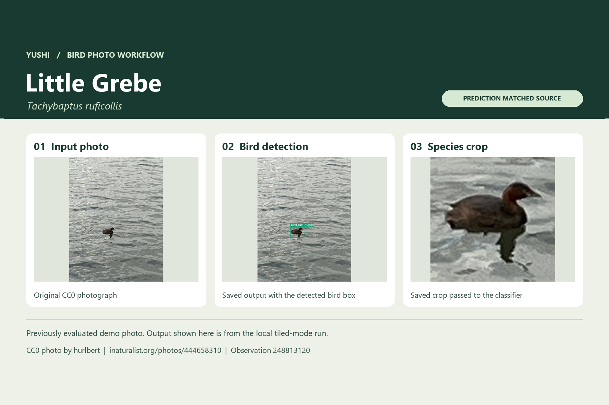

# 羽识中国鸟类识别模型

**YOLO11 · BioCLIP · 离线推理 · 计算机视觉**

[English](README.md) · 简体中文 · [日本語](README.ja.md)

羽识从照片中找到鸟，再对每只鸟的裁切图给出种名候选。项目主要面向**在中国分布的鸟类**，候选名录有 **1,343 种**。Windows 软件在本机推理，可查看检测框、实际送入分类器的裁切图、候选排序和待确认状态。

[苍鹭实例](media/grey-heron-workflow.png) · [图片和模型来源](CREDITS.md)

## 在什么基础上做了微调

| 环节 | 预训练基础 | V1.1 使用的训练与适配 |
| --- | --- | --- |
| 鸟类检测 | Ultralytics 预训练 **YOLO11n**（`yolo11n.pt`） | 用鸟框标注、难负样本和复杂场景做单类鸟检测微调。发布版使用冻结的第四版检测器。 |
| 鸟与背景复核 | ImageNet 预训练 **YOLO11n-cls**（`yolo11n-cls.pt`） | 用 6,270 张鸟类局部图和 5,778 张背景局部图做二分类微调，复核检测候选。 |
| 鸟种识别 | Imageomics **BioCLIP 2**（ViT-L/14）与 **BioCLIP 2.5**（ViT-H/14） | 两个图像编码器均保持冻结。BioCLIP 2 分支用 80 种、736 张支持照片适配分类头与确认规则。BioCLIP 2.5 分支把分类学文本分数和加权岭回归头结合，后者用 80 种、1,434 张可用裁切拟合。鸟种支持集面向中国鸟类，包含来自 iNaturalist 的公开观察照片。 |

默认把两个分支校准后的物种概率各取一半。每只鸟从原图生成带 1.2 倍上下文的方形裁切。鸟种识别的适配集中在分类头、确认规则和概率融合，图像编码器沿用预训练权重。

## AI OpenBuild 赛期工作

11 月 6 日的 Windows 版加入可选分块补检。每个窗口为 640 像素，步长为 480 像素，检查分块切边并合并重复检测，同时保留整图检测框。新增的初检交接把框与原图及检测配置绑定，后续阶段可校验并复用初检框，跳过重复的初检。交接在同一台 Windows GPU 电脑上验证。

## 实测结果

| 项目 | 结果 |
| --- | --- |
| 历史普通整图鸟种评测 | 95 种、188 张图，第一候选正确 **172/188**，此前分类器为 **169/188**。无框计错。 |
| 11 月 6 日既有样本回归 | **197/197** 完成并保留原有框。两种模式都覆盖 **69/70** 个天空鸟标注。 |
| 负样本 | 两种模式都在 **10/118** 张图出现检测框，均为 **0/118** 张确认鸟种。 |
| 分块新增框 | 评测扫描 **999** 个窗口，最终接纳 **0** 个新增框。 |

候选名录为 1,343 种，历史实测覆盖其中 95 种。这次分块回归检验了既有检测结果的保留情况。[发布验收数据](evidence/validation.json)

## 运行评审示例

执行 `python review/demo.py`，可以用合成 RGB 数据检查窗口坐标、内部切边和 JSON 交接校验。[分块源码](review/tiling.py)取自发布版。完整桌面软件需要配套 Windows 运行环境与模型资产，上方图示来自本机真实推理的保存结果。

**关键词** 中国鸟类识别、鸟种分类、YOLO11、BioCLIP、计算机视觉、离线推理、野生动物 AI
