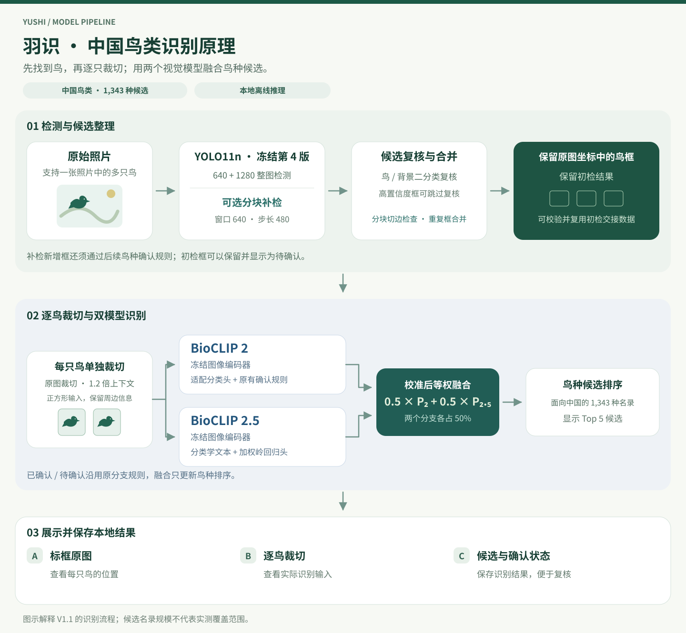

# 羽识中国鸟类识别模型

**YOLO11 · BioCLIP · 离线推理 · 计算机视觉**

[English](README.md) · 简体中文 · [日本語](README.ja.md)

**仅限非商业使用。** 作者原创内容与第三方组件分别适用相应条款，详见[使用声明](USAGE.md)。

羽识从照片中找到鸟，对每个保留的检测框逐鸟裁切，再给出鸟种候选排序。项目主要面向**在中国分布的鸟类**，候选名录包含 **1,343 种**。Windows 软件在本机运行，可以查看检测框、实际送入分类器的裁切图、鸟种候选以及确认或待复核状态。

系统由微调后的 **YOLO11n 鸟类检测器**、**鸟与背景复核器**，以及基于冻结 **BioCLIP 2、BioCLIP 2.5** 的适配分类分支组成。第四版检测器保持冻结，普通与分块模式共用同一套检测权重。

本仓库提供原理说明、可执行的分块与交接代码示例、真实推理图片和验收记录。完整桌面运行环境与模型权重另行打包；克隆本仓库后可以运行代码示例，运行完整识别软件仍需配套程序与模型资产。

## 识别原理

本实验分支新增了[逐鸟相似种复核 GUI](desktop_review/README.md)，从仓库根目录的 `启动相似种复核GUI.cmd` 启动，需配套现有 NVIDIA 运行包。保留批量照片、普通 / 分块和原双路结果，复核建议单独显示；柳莺为默认关闭的冻结实验建议，鸫类和麻雀仍未启用。



图中的照片、标框结果和裁切图来自冻结应用的一次重新实推，对应文件与运行记录见下方“本次真实推理示例”。

### 1. 先找到可能是鸟的区域

系统先以 640 推理尺寸进行整图初检，再以 1280 推理尺寸进行整图补检。两次检测都使用冻结的第四版 YOLO11n。

低置信度候选由背景复核器进一步判断，达到冻结配置中强检测条件的候选跳过这一复核。这个阶段判断图中哪些区域可能是鸟，之后才进行具体鸟种识别。

### 2. 按需进行分块补检

分块模式在上述流程上增加原图重叠窗口。图像尺寸允许时，每块为 640 × 640 像素，常规步长为 480 像素。通过重叠，让落在一块边缘的小鸟有机会在另一块中获得更完整的视野。

分块框会映射回原图坐标，触及内部切边的候选被排除，重复候选去重并保留优先框。1280 整图补检和分块补检的新增框都需要通过原 BioCLIP 2 分支的接纳规则。初检框即使暂时无法确认鸟种也会保留。

### 3. 从原图逐鸟裁切

每个最终保留框都从原始照片生成一个带 **1.2 倍上下文**的方形裁切，超出图像边缘的区域用固定灰色填充。这既突出鸟的外形，也保留少量周边信息。

两个鸟种分支接收同一份裁切，再分别进行各自编码器的输入预处理。程序同时保存实际分类裁切与紧框裁切。如果有多个保留框，每个框都会独立编号、裁切、识别和保存。下方两个实推示例各保留一只鸟。

### 4. 融合候选排序，保留确认规则

冻结的 BioCLIP 2 与 BioCLIP 2.5 提取图像特征，交给面向中国鸟类适配的分类分支。默认选择 `blend50_N_ridge`，将两个分支校准后的物种分布各取一半。

```text
最终鸟种排序 = 0.50 × BioCLIP 2 分支 + 0.50 × BioCLIP 2.5 分支
```

融合用于更新鸟种候选排序，是否接纳、是否像鸟以及待复核状态沿用原 BioCLIP 2 分支的判定。候选得分与“已确认”是不同信息。

## 本次真实推理示例

**2026 年 11 月 10 日**，使用冻结 Windows GPU 程序，对两张已有的 CC0 示例照片重新运行分块检测与高精度融合分类。它们用于展示当前真实运行结果，属于已知样本的重新推理，不构成新的独立准确率测试集。

| 照片 | 保留鸟数 | 第一候选 | 程序状态 | 实际分类裁切尺寸 | 分块新增框 |
| --- | --- | --- | --- | --- | --- |
| 小䴙䴘 | 1 | *Tachybaptus ruficollis* | 已确认 | 137 × 137 | 0 |
| 苍鹭 | 1 | *Ardea cinerea* | 已确认 | 76 × 76 | 0 |

- 小䴙䴘 — [原始照片预览](media/recognition-example/original.jpg)、[程序保存的标框图](media/recognition-example/annotated.jpg)、[实际分类裁切](media/recognition-example/crop.png)。
- 苍鹭 — [原始照片预览](media/recognition-example/grey-heron/original.jpg)、[程序保存的标框图](media/recognition-example/grey-heron/annotated.jpg)、[实际分类裁切](media/recognition-example/grey-heron/crop.png)。
- [运行证据](evidence/recognition-example.json)包含候选、坐标、设备、模型与配置哈希、裁切哈希及照片来源。

两张照片分别检查了 4 个分块，均保留普通模式结果。推理前后的检测权重和配置哈希一致。公开的 JPEG 预览仅做去元数据与重新编码，检测框未重新绘制；每份 `crop.png` 与程序保存的实际共享分类输入 PNG 字节一致。

此前保存的[小䴙䴘流程图](media/little-grebe-workflow.png)和[苍鹭流程图](media/grey-heron-workflow.png)也保留在仓库中。图片署名和上游模型来源见[来源说明](CREDITS.md)。

## 在什么基础上做了微调

| 组件 | 预训练基础 | V1.1 采用的训练与适配 |
| --- | --- | --- |
| 鸟类检测器 | Ultralytics **YOLO11n**，`yolo11n.pt` | 用鸟框标注、难负样本及复杂场景做单类鸟检测微调，应用冻结使用第四版检测器。 |
| 背景复核器 | ImageNet 预训练 **YOLO11n-cls**，`yolo11n-cls.pt` | 用 **6,270 张鸟类局部图**与 **5,778 张背景局部图**做二分类微调，复核低置信度候选。 |
| BioCLIP 2 分支 | Imageomics **BioCLIP 2**，ViT-L/14 | 图像编码器冻结，使用 **80 种、736 张支持照片**适配分类头与确认规则，并提供原接纳判定。 |
| BioCLIP 2.5 分支 | Imageomics **BioCLIP 2.5**，ViT-H/14 | 图像编码器冻结，将分类学文本分数与加权岭回归分类头结合，后者使用 **80 种、1,434 张可用裁切**拟合。 |
| 最终候选排序 | 两个分支校准后的输出 | 等权概率融合，保留原接纳与待复核判定。 |

历史检测训练记录涉及 **CUB-200-2011、COCO、FBD-SV-2024、IBERBIRDS 和网络难负样本**。鸟种分类头则使用独立的、面向中国鸟类的支持照片池，其中包含 iNaturalist 公开观察照片。鸟框与负场景用于学习“哪里有鸟”，带种名的支持图片用于适配“是什么鸟”。

两个 BioCLIP 图像编码器沿用预训练权重，本地鸟种适配集中在分类头、确认规则和概率融合。发布配置没有对两个 BioCLIP 编码器做端到端重训练。

需要区分三个统计口径：**候选名录 1,343 种**、**上述支持集覆盖 80 种**、**历史评测覆盖 95 种**。候选名单中存在某个鸟种，不等于已经测得它的识别准确率。

## 普通模式与分块模式

| 配置 | 普通模式 | 分块模式 |
| --- | --- | --- |
| 冻结的 640 整图初检 | 有 | 有 |
| 1280 整图补检 | 有 | 有 |
| 640 像素重叠窗口 | 无 | 有，常规步长 480 像素 |
| 第四版检测权重 | 同一套冻结权重 | 同一套冻结权重 |
| 逐鸟裁切与鸟种识别 | 有 | 有 |
| 普通模式已有结果 | 保留 | 作为原始输出前缀保留 |

当宽和高都不超过 640 像素时，不追加窗口。最多扫描 **256 块**，超过上限会提示先裁出需要检查的区域，不会只扫描部分图像后显示全部完成。边缘对齐时的重叠可能大于常规 25%。

冻结初检参数为 `imgsz=640`、`conf=0.16`、`iou=0.7`、`classes=[0]`。背景复核阈值为 `0.15`，检测置信度达到 `0.35` 时免复核。分块补检使用独立的候选阈值 `0.05`，之后还要筛选和去重。这些参数作用于不同阶段，不能当成可以互换的调参建议。

分块是推理方式，不是额外训练的一份 `.pt`。它的用途是缩小每次检查的图像范围，给整图缩放后变小的目标更多检测机会；新增候选也需要复核。是否提升召回率，应在实际使用场景中单独验证。

## 完整 Windows 软件如何使用

以下步骤适用于另行打包的完整桌面程序。

1. 将整个安装包完整解压到可写目录，启动 `鸟类识别.exe` 或 `启动鸟类识别.cmd`。
2. 添加一张或多张照片。GUI 默认选择“分块补检（优先找小鸟）”“高精度融合版”和“自动（优先 NVIDIA）”。
3. 需要较少检测次数时选择“普通整图（更快）”，需要额外检查局部区域时选择分块模式。鸟种识别选项独立提供高精度融合版和上一版 N 作为对照。
4. 点击“开始识别”，界面会显示实际处理阶段。首次模型加载耗时通常长于后续照片处理。
5. 选择左侧照片查看标框结果，再选择某只鸟，查看实际裁切、中文种名、学名及前五候选。
6. 打开结果目录检查保存文件。清空 GUI 列表不会删除已保存的结果。

当前界面用于本地照片及批量处理，不会自动打开摄像头，也未内置远程接收服务。用户选择的照片在本机处理，不会由应用上传到服务器。

### 输出文件与得分含义

| 保存文件 | 内容 |
| --- | --- |
| `snapshot.png` | 本次推理使用的 RGB 图像快照 |
| `annotated.png` | 检测框与显示结果 |
| `bird_001.png` 等 | 实际交给鸟种分支的 1.2 倍上下文方形裁切 |
| `bird_001_tight.png` 等 | 检测框范围的紧框裁切 |
| `result.json` | 坐标、前五候选、复核状态、裁切路径、检测来源及耗时 |

原始照片保留，每次运行写入独立目录。逐鸟编号用于对应检测框、裁切图和识别结果。

**检测置信度**评价某个区域的检测结果，**鸟种得分**用于该裁切的候选排序，**已确认／待复核**遵循冻结判定规则。界面上接近 1 的分数属于单张图的模型输出，不代表整个系统的实测准确率，也不能保证该次识别一定正确。

## 已有实测结果

| 评测项目 | 结果与范围 |
| --- | --- |
| 历史普通整图鸟种评测 | **95 种、188 张图**，第一候选正确 **172/188，即 91.49%**；此前分类器为 **169/188**。无检测框的照片计错。 |
| 11 月 6 日既有样本回归 | **197/197** 完成并保留原有检测，包含 70 张天空场景、118 张负样本及 9 张鸟种照片。 |
| 天空鸟标注框覆盖 | 普通 **69/70**，分块 **69/70**；其中天空小目标两种模式均为 **5/5**。 |
| 出现检测框的负样本照片 | 两种模式均为 **10/118**，各产生 14 个框。 |
| 确认了鸟种的负样本照片 | 两种模式均为 **0/118**。检测误框与鸟种确认分别统计。 |
| 该次回归的分块检查 | **999 个窗口、309 个候选、0 个接纳的新增框**。 |
| 初检交接 | 在一台 Windows GPU 电脑上完成 JSON 往返，续接阶段重复初检 YOLO 调用 **0 次**；不同像素与被改动的包均被拒绝。 |

188 张鸟种测试评价选定的普通流程，197 张回归检查已用控制图片上的保留情况和误检表现，本次两张实推展示当前执行与保存裁切。三者的样本和用途不同。历史 91.49% 不等于分块模式或全部 1,343 种的准确率。

完整记录见[历史验收数据](evidence/validation.json)与[本次示例实推记录](evidence/recognition-example.json)。该次分块回归验证了已有结果保留，未在那组图片上证明额外召回提升。

## 初检与后续识别如何交接

完整程序提供两个逻辑阶段。初检端执行冻结的 640 检测与背景复核；处理端接收**同一张原始 RGB 图像**和 `bird-initial-v1` JSON，验证后复用初检框，继续补检、裁切与鸟种识别。

初检包绑定图像尺寸、像素 SHA-256、检测模型哈希、检测配置、框及计数。校验器会检查数据包摘要与这些字段。摘要用于发现内容不一致，不是身份认证或数字签名。

合法初检包可以省去重复初检，后续补检仍按选定模式执行。离线流程允许空初检包继续补检；如果未来摄像头设备只发送初检命中的帧，完全漏检且没有发送的帧无法由后续分块找回。

目前该分工接口在一台 Windows GPU 电脑上验证，代表处理阶段的拆分。仓库没有附带网络协议服务或已通过实机验收的树莓派部署。

## 运行本仓库的代码示例

代码示例仅依赖 Python 标准库，使用合成 RGB 数据验证窗口坐标和初检包校验，不加载模型权重，不执行鸟种推理。

```bash
git clone https://github.com/mmax911110-lgtm/yushi-china-bird-recognition.git
cd yushi-china-bird-recognition
python review/demo.py
```

输出包括 1440 × 960 示例尺寸生成的 6 个窗口、分块框映射后的原图坐标、内部左切边、1 个 JSON 交接框以及不同像素被拒绝的结果。`review/tiling.py` 是应用中提取的分块与交接模块，`review/demo.py` 是对应的可执行小示例。

## 仓库文件结构

```text
.
├── README.md / README.zh-CN.md / README.ja.md
├── USAGE.md                       使用声明与第三方范围
├── CREDITS.md                     模型与照片来源
├── review/
│   ├── demo.py                    标准库代码示例
│   └── tiling.py                  分块坐标与交接校验
├── evidence/
│   ├── validation.json            历史测试与回归验收
│   └── recognition-example.json   本次实推记录与哈希
└── media/
    ├── recognition-pipeline.*.svg  三语原理图
    ├── recognition-example/
    │   ├── original.jpg / annotated.jpg / crop.png
    │   └── grey-heron/             第二张照片对应的同类文件
    ├── little-grebe-workflow.png   此前保存的流程实例
    └── grey-heron-workflow.png
```

## 完整部署需要的文件与运行环境

运行完整系统需要以下配套组件。单独替换一个 YAML 或检测权重，不能提供其余鸟种识别功能。

| 组件 | 必须承担的作用 |
| --- | --- |
| 应用代码与启动器 | GUI、检测、裁切、分类、保存和启动流程 |
| 检测器与复核器 `.pt` | 冻结的鸟类检测和背景筛选 |
| BioCLIP 权重及模型配置 | 两个预训练图像编码器 |
| 鸟种分类头及文本特征资产 | 适配头、分类学分数与背景特征 |
| 冻结配置与鸟种标签 | 阈值、标签顺序、融合方案及模型身份 |
| Python 与推理运行环境 | 配套 PyTorch、OpenCLIP、图像处理、Tkinter 与本地依赖 |
| 许可与完整性信息 | 组件条款、来源与文件哈希校验 |

参考程序运行于 **Windows x64**，实测显卡为 **NVIDIA GeForce RTX 5060 Laptop GPU，8 GB 显存**。文中鸟种参考运行采用 CUDA BF16 推理。程序提供 CPU 选项，但 CPU 和其他 GPU 配置尚未完成同等范围的准确率回归。首次加载、图片大小、分块数量与分类方案都会影响耗时和内存占用。

打包的 Windows 运行环境不能原样用于树莓派 Linux ARM。仓库中的测量不包含树莓派部署、速度或最低硬件要求的实机验收。

## 使用与来源声明

作者原创内容仅供个人学习、教学及非商业研究使用。商业使用须事先取得作者书面同意。第三方代码、模型与照片仍遵循各自原有许可，本声明不改变其授权条款。

具体使用范围见[使用声明](USAGE.md)，模型与图片出处见[来源说明](CREDITS.md)。公开展示的示例照片记录为 CC0，训练数据集和完整模型资产未包含在本仓库中。

**关键词** 中国鸟类识别、鸟种分类、YOLO11、BioCLIP、分块检测、计算机视觉、离线推理、野生动物 AI
