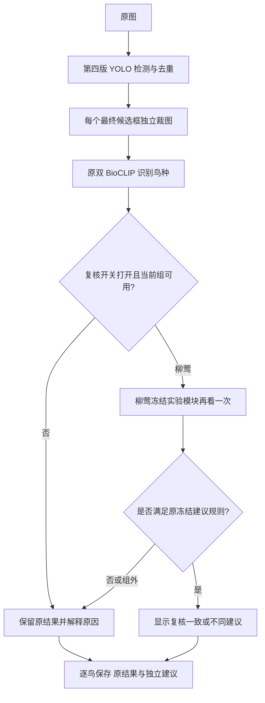

# 逐鸟识别与独立相似种复核 GUI

此入口复用完整 NVIDIA 软件的照片 GUI、第四版 YOLO11n 和 BioCLIP2 / BioCLIP2.5 双路分类器。保留照片批量处理、普通整图 / 分块补检、逐鸟裁图预览、Top5、融合版 / 上一版 N 对照以及原结果导出。原软件目录与研究冻结文件不需要修改。

## 在当前电脑启动

双击仓库根目录的 `启动相似种复核GUI.cmd`。工作区根目录也提供同名快捷启动脚本。

1. 添加照片，选择普通或分块检测。
2. 默认使用高精度双路分类；相似种复核默认关闭。
3. 如需查看柳莺实验建议，勾选“相似鸟复核”。开关按整批固定，处理中不可更改。
4. 开始识别；选择每只鸟查看它自己的实际裁图、原候选和独立复核状态。
5. “复核流程 / 模块状态”解释当前可用模块。“打开本次结果”查看导出文件。

## 现在什么条件会复核

所有鸟候选先完成原识别，再独立判断。没有额外的面积、远近或主模型高置信豁免。

| 当前第一候选 | 打开复核后实际行为 |
|---|---|
| 黄腰柳莺、黄眉柳莺、褐柳莺、极北柳莺 | 进入原冻结柳莺 R2 实验复核；可以弃权 |
| 本轮 6 种鸫类，或麻雀 / 山麻雀 | 显示“该组未启用建议，保留原判”，不加载失败候选头 |
| 其他鸟种 | 显示“未触发”，保留原结果 |
| 上一版 N 对照 | 保留原分类流程；此专项需要双路特征，显示不支持 |

进入柳莺复核不代表允许建议。种名建议继续使用原冻结规则：主 Top2 同组、主分数差不超过 0.5、两者分数和至少 0.3；专项非 OTHER，组内条件分数至少 0.85、前两名差至少 0.25，建议仍须在原 Top2。未达标显示不确定。复核不提高原来的“待确认”状态，也不自动改判。

新入口按原 Top1 分组；组外混淆邻接路由有独立测试覆盖，但**默认邻接表为空，没有配置任何组外触发关系**。多个组冲突时弃权。它没有从已观察测试错误中建立规则，也没有更换冻结头或阈值。扩展后的入口并非已经完成新的独立准确率评测，柳莺仍标明实验建议。



OTHER 只代表不属于这个相似组，不能解释为没有鸟。任何专项输出都不会删除原框、覆盖原种名、Top5、概率或确认状态。每个裁图只复核一次，不把建议送回主网络反复循环。

## 需要的本地资产

Git 仓库不包含大型权重、Python 运行环境或鸟照片。需要已有完整 NVIDIA 软件包，以及原 `species_rejection_20261114` 柳莺冻结实验资产。GUI 和主识别在缺少专项时仍可使用，专项显示不可用。

- 软件包：`app/gui.py`、`app/engine.py`、`app/inference/`、`configs/`、`models/` 和完整 `runtime/`；保持原包完整。
- 柳莺：`frozen_expert.json`、`frozen_decision.json`、`frozen_review_policy.json`、`heads/species_aware_OTHER_bio25_C0p1/head.npz`。
- 复核会检查原类别目录与上述模型、规则的哈希；不加载训练代码。

当前电脑启动脚本默认指向 `D:\项目\鸟类识别\识别模型\v1\v1.1\NVIDIA`。其他电脑可通过 `BIRD_NVIDIA_PACKAGE` 设置软件包，`BIRD_RESEARCH_ROOT` 设置包含 `species_rejection_20261114` 的父目录，也可使用命令行：

```powershell
& 'NVIDIA/runtime/python.exe' -X utf8 -B -I -S desktop_review/launch.py `
  --package 'NVIDIA' --research '研究目录' --output '输出目录'
```

默认输出为本仓库 `outputs/desktop-review/`；日志与缓存也写在这个新目录，不写入原 NVIDIA 包。

## 保存什么

原 `result.json`、标框图和所有逐鸟裁图按原程序保存。另生成 `similar_species_review.json` 与 `.html`，按鸟号记录坐标、裁图哈希、原识别、路由原因、专项状态、独立建议及冻结模型绑定。GUI 使用这份独立记录；原 `result.json` 字节不被复核改写。专项的组内分数不等于 1,343 种全词表置信度。

## 验证与实现范围

```powershell
# 路由、冻结头数学、失败隔离、真实Tk合成多鸟界面；不加载视觉模型
& 'NVIDIA/runtime/python.exe' -X utf8 -B -I -S desktop_review/launch.py --test

# 使用既有验证图片，真实GPU比较原程序与集成入口的普通/分块输出
& 'NVIDIA/runtime/python.exe' -X utf8 -B -I -S desktop_review/launch.py --verify-runtime
```

后一项用于工程回归，**不构成新的独立准确率测试**，不调整模型或阈值。报告保存在 `outputs/desktop-review/runtime-verification/report.json`。CPU 界面测试使用明确标记的合成数据，不冒充模型结果。

- `routing.py`：不读取置信度或图片的逐鸟分组、冻结状态、冲突与弃权。
- `backend.py`：原推理适配、同一次 BioCLIP2.5 特征捕获、柳莺 NumPy 推理、独立导出。
- `gui.py`：继承现有完整照片 GUI，新增开关、逐鸟状态和流程说明。
- `launch.py`：使用原离线环境，隔离新增缓存与输出。
- `test_*.py`、`verify_runtime.py`：CPU / Tk 验证和已知图片实推回归。

本次没有训练、没有增加视觉骨干、没有修改第四版权重和双 BioCLIP 权重，也没有启用鸫类 / 麻雀失败候选。
